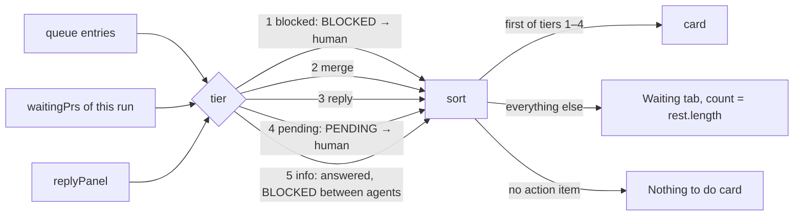

# Runs list and pipeline

## What it is

Screen 1: a full-height left sidebar (the title, the runs list, and `Add repo`, which opens the folder picker in a modal dialog) and a main column with the selected run's header and ⋯ menu, the run's **flow**, its **Next step** card, and the Waiting and Log tabs. Covers the features.md rows Screen 1 (all five), Waiting tab, Other activity, Unsupported docs and no runs, and the page side of Merge, Reply panel, Autopilot run, and Continue and auto-continue. Run rules are pure in `packages/model/src`; screen 1's views are pure in `packages/web/src/screens/runs` (`next-step`, `plan-view` (the flow's columns and the header), `tab-memory`, `menu-view`, `waiting-tab`, `folder-picker`, `add-dialog`); components are glue.

## How it works

- **Which runs:** each plan not archived or finished, plus each plan or `fix-<slug>` a claim file names. A claimed archived plan stays while its hand-back entry is pending, while halted, or while an agent of it wrote in the last 30 minutes. Agents join a plan by its `plan` field, a sprint, or their role ([run-model.md](run-model.md)).
- **State,** first match: `blocked` → `needs-you` (a queue item for you, or a PR in `waitingPrs`) → `running` → `idle`. Pipeline steps: `blocked` → `done` → `you` → `live` → `wait`.
- **Autopilot runs** (a `<!-- autopilot-run` line in the active sprint doc): their wave PRs read `PR #N · autopilot merges` and aren't in `waitingPrs` until autopilot stops for you (a `BLOCKED`, or a `PENDING` starting with its gate), then `PR #N · autopilot stopped` with Merge. No Go step.
- **Times:** active minutes only; gaps over 15 minutes (30 when they end in the awaited tool result) don't count.
- **Next step** (`nextSteps`): every item that waits on you, sorted by tier, list order kept within a tier. The first item of an action tier is the card; the rest go to the Waiting tab.

  Example (chess-web `sparring-ladder`, autopilot halted at gate 3, wave 3 PR #78 pushed): the `BLOCKED · orchestrator → human` halt is the card with Answer and "The run is stopped until you answer."; `rest` starts with `Merge PR #78` ("Wave 3 of ladder is handed back to you."), then the fixture's other entries. With a gate 6 `PENDING` halt instead, `Merge PR #78` is the card and the halt waits in the tab.
- **Card:** label, status dot and word, title, detail, one action. Answer and Merge open in place under the card with the card's own flow; a reply shows its rows (`ReplyPanel framed={false}`). `Nothing to do` is the dashed `.card.calm` with no button; its detail is `run.where`, or `emptyMessage` for an error, unsupported or plan-less row.
- **Header** (`runHeader`): repo crumb, plan name (`fix · <slug>` for a fix run), and the ⋯ menu at the right end.
- **Flow** (`flowColumns`, `Flow`): one column per stage of `buildPipeline` (Plan, Sprint N of M, Check, Ship) or `buildFixPipeline` (Build, Review, Ship), a stage with no steps left out, an `arrow-right` icon between columns. Each card: an SVG mark (`check` done, `dot` running, `alert` needs you, `blocked` blocked, `circle` waiting or unknown) in its status colour, the step's label, its state word for screen readers, and its detail in muted mono. Running, needs-you and blocked cards (`hi`) get a border in their status colour; waiting and unknown ones (`dim`) take muted text and a faint mark. No Merge button: the Next step card (or the Waiting tab) holds it. `Open the wave board` sits under a plan's flow. A plan-less row has no flow.
- **Tabs:** Waiting and Log. One open tab per browser in `localStorage` `pod-board-tab`; nothing stored, or a `plan` stored before the Plan tab went away, means all closed. On `/agent/<id>` the Log tab shows open without saving.
  - **Waiting:** route and date, body clamped to two lines until clicked; Answer only on entries routed `→ human`, with `answerNote`; Merge on a PR row; the reply rows.
  - **Log:** the slice log (a fix run: its agent log and engineer view), Other activity (the repo's agents in no run, last 2 h, newest 8), and the Action log (newest 20).
- **Reply rows:** each word, its why, Copy, and Continue or Go when sendable. The session line, the no-session note, `cd` and `claude --resume` sit behind `Run it yourself`.
- **Sidebar:** "Pod Board", with `lost · retrying` beside it only while the stream is lost (health checked every 5 s, 4 s limit); `Runs · N active`; the runs, one short card each (repo; the status dot and word top right, on the name's line; the `fix` tag under the name), 12 px apart, with the selected one on the hover background with the strong border; `Add repo` a regular 40 px button as wide as the cards, icon and label centred; `Add repo` at the bottom. The ⋯ menu, in the run header (or beside "No repos yet"), holds Auto-continue for the selected run, System / Dark / Light, and `Ports <n>` for a claimed run; Escape or an outside press closes it and returns focus. `Add repo` opens the folder picker in a modal dialog (Escape, Close or a backdrop click closes it). Under the path box one line of plain crumbs (`crumbsFor`: `This PC › E: › Projects`, or `/ › home › ann`); each opens its folder, the first one the roots, and the last is the current folder. Past three crumbs, `foldCrumbs` keeps the root and the last two and folds the rest into a `…` menu (placed against the window by `foldMenuPlace`, so the dialog can't clip it). Folder crumbs shrink first; the current one only ends in an ellipsis past its cap. The picker starts in the parent most repos share (the roots with none), lists folders with `pod-docs` marks, filters as you type (150 ms), and Add posts to `POST /api/repos`, closing the dialog and returning focus to `Add repo`.
- **Layout:** a 260 px full-height sidebar with a right border, then the main column, each part at most 720 px and centred in the space beside the sidebar; the flow is as wide as its columns (208 px each, shrinking to 152 px), up to 1200 px, centred too, and scrolls sideways inside its own box below that, with the wave board link held in view (sticky); the wave board (`/board`) takes the full width with the header and `Back to the run`. At 820 px and below the sidebar stacks on top; at 480 px and below `Runs · N active` hides so the card and its button fit a 375 × 667 screen.

## Why it's this way

- **One next step, the rest behind closed tabs** ([plan](../plans/calm-dashboard.md#key-decisions)): the old screen showed every control at once. Turned down: a card across all runs; the runs list already marks other runs.
- **The card picks only from the model's rules**, so it can't disagree with the wave board or the merge routes. Wording and the halt-versus-PR order are agent defaults ([wording](../decisions.md#2026-10-28--next-step-card-wording-agent-default--override-anytime), [halt](../decisions.md#2026-10-28--an-autopilot-halt-and-a-waiting-pr-on-the-next-step-card-agent-default--override-anytime)).
- **A folder browser, not the OS dialog** ([research](../research/folder-picker.md)): no browser picker returns a full path, and a native dialog can open behind the browser. Add needs a whole folder name, so a partial name never adds its parent ([decision](../decisions.md#2026-10-28--folder-picker-add-with-a-partly-typed-name-agent-default--override-anytime)).
- **Controls open in place, never a modal; no red on Merge** (plan Looks): the confirm step carries the weight. The one exception is `Add repo`: the human asked for the folder picker in a modal dialog (fix-sidebar-add-dialog); it isn't about the selected run.
- **A full-height sidebar, not a top bar:** the human asked for the layout from before plan calm-dashboard back, keeping the calm-dashboard look.
- **A claimed plan stays a run through close-out:** pod archives the plan before the final merge and waits for `continue`. Turned down: ending it at the merge (review round 1 of #33).
- **Autopilot's wave PRs aren't yours** until it stops ([decision](../decisions.md#2026-10-26--autopilot-runs-show-their-wave-prs-as-autopilots-agent-default--override-anytime)); **times skip idle gaps** ([decision](../decisions.md#2026-10-26--slice-times-skip-idle-gaps-over-15-minutes-agent-default--override-anytime)); **only listed runs show their entries** ([decision](../decisions.md#2026-10-22--only-listed-runs-show-their-queue-entries-agent-default--override-anytime)).

## Watch out

- Key `NextStepCard`, `WaitingTab` and `BarMenu` by the run, and keep the card's reply slot mounted for any run with a plan: otherwise a Continue result vanishes when the Board drops the reply. It shows on the next card until Close.
- After Answer saved from the card, the card moves on, so focus lands on `body`.
- An answer doesn't clear `needs-you`: the row reads answered until pod resolves the entry.
- The flow's Go card reads `unknown · not recorded yet`, dim, even after later steps start (queue, someday).
- The flow's box is the positioned parent of the cards' `.sr-only` words; without `position: relative` they escape the scroll box and widen the page (828 px at 375 px).
- Two repos with the same folder name show as two identical rows (queue, someday).
- The board can't read a review verdict: after a failed round 1 a fix run reads `needs-you`.
- A plain `PENDING · orchestrator → human` note that starts with a gate name reads as an autopilot stop.
- chess-web's `ladder` sprint keeps its autopilot marker; delete it from a copy to see `you merge`. A Merge card on a fixture copy needs the smoke recipe's stub `gh`.

## History

- 2026-10-18: added in sprint server-runs (slice P1).
- 2026-10-19: banners, docs version messages, and theme boot added in sprint board-engineer (slice X1).
- 2026-10-19: a done wave reads `done` even with a pending ask for the human; `you` only on unfinished waves (decision "`you` only on unfinished waves", sprint board-engineer wave 2 fix).
- 2026-10-19: reviewers and sprint planners now carry their plan from real dispatches (`readDispatch`, see run-model.md), so `final review`, the Check stage's live round, and `drafting` show for real runs (plan board-read fix pass).
- 2026-10-19 · board-read · plan complete; theme boot moved to `app-shell.md`; round 2 found the prose `plan slug` bug, still open · [report](../reports/board-read.html)
- 2026-10-19: a dispatch field quoted in prose never beats the real list field, so a round 2 reviewer keeps its plan in `final review` and the Check stage shows `round 2` live (plan board-read fix 2).
- 2026-10-19: dispatch fields count at a line, list item, sentence, or ` · ` part start again, so running engineers keep their slice row and the run reads `running` (plan board-read fix 3).
- 2026-10-19: a `Plan: E:/…` drive path no longer hides a planner's prose plan, so it shows `drafting`; fenced examples never count (plan board-read fix 4).
- 2026-10-20 · board-read · final review passed at round 5, with every row driven live · [report](../reports/board-read.html)
- 2026-10-20 · fix-closeout-idle · a live claim keeps its plan listed through the close-out (`closing out`, then `final PR`), and the reporter joins its plan, so a closing-out run no longer reads `no active plan · idle`.
- 2026-10-20 · fix-closeout-idle round 1 · a claimed archived plan leaves the list once its hand-back isn't pending and none of its agents wrote in 30 minutes, so a leftover claim no longer shows a finished plan as `closing out` forever.
- 2026-10-20 · fix-show-fix-runs · `/pod:fix` runs show on the runs list with a `fix` tag, their own pipeline (Build, Review, Ship by head-branch PR) and agent log, and no wave board; agents tied to no run show in an Other activity strip ([decision](../decisions.md#2026-10-20--fix-runs-on-the-board)).
- 2026-10-20 · fix-show-fix-runs round 2 · a continued agent reads running until it hands back again, and its turns are their own steps and log rows: the engineer resumed after the review is the fix pass, the reviewer resumed after it round 2. So a running round 2 no longer reads `needs you`.
- 2026-10-21 · fix-final-pr-early · Ship shows the final PR found by head branch `<plan-slug>` before the hand-back exists, so the final review and close-out no longer read `not open yet` ([decision](../decisions.md#2026-10-21--find-a-plans-final-pr-by-its-branch-any-base-agent-default--override-anytime)).
- 2026-10-20 · fix-show-fix-runs round 1 · an open fix PR reads `review · idle` with Ship `after review` until the agent that wrote last is an ended reviewer, and a closed fix PR is asked about again, so a reopen shows.
- 2026-10-21 · merge-actions P1 · one rule (`waitingPrs`) for PRs waiting on you; a handed-back wave reads `you` with `PR #N · you merge` and its run `needs-you`, and waiting steps carry `merge`.
- 2026-10-21 · merge-actions U1 · a step with a PR waiting on you gets a Merge button that opens the confirm in place, shows GitHub's result, and the action log lists the newest 20 actions under Other activity.
- 2026-10-21 · queue-and-replies R1 · a Reply panel under the bar names the reply pod waits for (`continue`, `try`, or `go`), why, and the chat to paste it in, each line with a Copy button.
- 2026-10-22 · queue-and-replies U2 · a Waiting on you list under the main view shows the run's queue entries for you, and an Answer button opens a form in place that appends your answer to the entry's line.
- 2026-10-22 · resume-runs U1 · an `auto-continue` switch beside the run's state chip turns the board's automatic `continue` on or off per run, and the Reply panel's sendable rows get Continue or Go buttons that resume the session from the board.
- 2026-10-22: a claimed archived plan stays a run while its hand-back entry is pending, also after the PR merges; the final PR stops waiting on you once merged (board-actions plan fix, review of #33).
- 2026-10-27 · fix-answer-note · the Answer form note has no chat step: a plan run says `Answer here, then press Continue. pod reads it when the run continues.`; a fix run or repo row says `Answer here. pod reads it when a /pod:code run next starts a wave.`
- 2026-10-22 · board-actions · plan complete: Merge, action log, Reply panel with Continue and Go, the auto-continue switch, and Waiting on you; final PR #33 passed review at round 2 after fix PR #34 · [report](../reports/board-actions.html)
- 2026-10-24 · fix-answered-continue · fixed: the Reply panel stayed on the page after its reply went away, because screen 1's siblings shared one key.
- 2026-10-25 · fix-health-probe-timeout · fixed: a health check that hung kept the chip `live` on a dead server; it now fails after 4 s.
- 2026-10-26 · fix-autopilot-view · fixed: an autopilot run's waiting wave PR read `you merge` with a Merge button, and the plan showed a `Go · not recorded yet` step; now it reads `autopilot merges` (or `autopilot stopped`, with Merge, once autopilot stops for you, at a BLOCKED halt or a PENDING gate such as gate 6) and has no Go step. Slice, wave, and fix-run minutes leave out idle gaps over 15 minutes, so a slice whose laptop slept no longer reads 1195 min.
- 2026-10-26 · fix-answer-only-yours · fixed: Answer showed on every pending BLOCKED, including ones between agents, where an answer did nothing; it now shows only on entries routed to you.
- 2026-10-28 · calm-screen S1 · screen 1 redrawn: a bar with `+ Repo` (the folder picker) and the ⋯ menu, a run header with the progress strip, one Next step card, and Waiting, Plan and Log tabs closed until opened. The Add a repo form, the `live` chip, the pipeline row, the Waiting on you list, and the Pipeline / Wave board tabs are gone.
- 2026-10-28 · calm-dashboard · plan complete: screen 1 rebuilt around one Next step card, closed Waiting / Plan / Log tabs, a bar with `+ Repo` (folder picker) and the ⋯ menu, and a run header with a progress strip; final PR #54 passed review at round 1 · [report](../reports/calm-dashboard.html)
- 2026-10-28 · fix-sidebar-add-dialog · the top bar is gone and the full-height left sidebar is back: "Pod Board" (with `lost · retrying`), `Runs · N active`, the short run rows, and `Add repo` at the bottom, which opens the folder picker in a modal dialog. The ⋯ menu moved to the right end of the run header, and beside "No repos yet" when there is no run. Each run is its own card again (a small gap, no shared box with divider rows), and the 720 px main column is centred in the space beside the sidebar; the wave board stays full width. Then: run cards 12 px apart with the status in the top-right corner and the `fix` tag under the name; `Add repo` as wide as the cards; and in the folder picker, path crumbs replace the square Up button beside the path box. Then: the crumbs lost their Up button, long paths fold their middle folders into a `…` menu instead of wrapping, and `Add repo` became the regular 40 px size. Then: crumbs size to their text (no min-width, even gaps around the arrows), and icon + label buttons balance on their ink: a plus that fills its box, a 1.75 px stroke beside a label, a 6 px gap, and `Add repo` centred on the plus's ink.
- 2026-10-29 · fix-run-flow · the run's flow is back as screen 1's main content, between the run header and the Next step card: columns of step cards with arrows (Plan, Sprint N of M, Check, Ship; Build, Review, Ship for a fix run), SVG status marks, and a status-coloured border only on running, needs-you and blocked cards. It may grow past the 720 px column (cards 208 px, up to 1200 px), centred, and scrolls in its own box on phones. The Plan tab is gone (a stored `plan` opens nothing), `Open the wave board` moved under the flow, and the header's progress strip and `Wave N of M` went, since the flow shows both.
