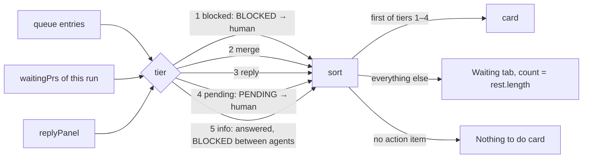

# Runs list and pipeline

## What it is

Screen 1: a full-height left sidebar (the title, the runs list, and `Add repo`, which opens the folder picker in a modal dialog) and a main column with the selected run's header and ⋯ menu, the run's **flow**, its **Next step** card, and the Waiting and Log tabs. Covers the features.md rows Screen 1 (all five), Waiting tab, Other activity, Unsupported docs and no runs, and the page side of Merge, Reply panel, Autopilot run, and Continue and auto-continue. Run rules are pure in `packages/model/src`; screen 1's views are pure in `packages/web/src/screens/runs` (`next-step`, `plan-view` (the flow's columns and the header), `tab-memory`, `menu-view`, `waiting-tab`, `folder-picker`, `add-dialog`); components are glue.

## How it works

- **Which runs:** each plan not archived or finished, plus each plan or `fix-<slug>` a claim file names. A claimed archived plan stays while its hand-back entry is pending, while halted, or while an agent of it wrote in the last 30 minutes. Agents join a plan by its `plan` field, a sprint, or their role ([run-model.md](run-model.md)).
- **State,** first match: `blocked` → `needs-you` (a queue item for you, or a PR in `waitingPrs`) → `running` → `idle`. Pipeline steps: `blocked` → `done` → `you` → `live` → `wait`; the flow adds `unknown` (not recorded) and `skipped` (the plan didn't take the step).
- **Autopilot runs** (a `<!-- autopilot-run` line in the active sprint doc): their wave PRs read `PR #N · autopilot merges` and aren't in `waitingPrs` until autopilot stops for you (a `BLOCKED`, or a `PENDING` starting with its gate), then `PR #N · autopilot stopped` with Merge. No Go step.
- **Times:** active minutes only; gaps over 15 minutes (30 when they end in the awaited tool result) don't count.
- **Next step** (`nextSteps`): every item that waits on you, sorted by tier, list order kept within a tier. The first item of an action tier is the card; the rest go to the Waiting tab.

  Example (chess-web `sparring-ladder`, autopilot halted at gate 3, wave 3 PR #78 pushed): the `BLOCKED · orchestrator → human` halt is the card with Answer and "The run is stopped until you answer."; `rest` starts with `Merge PR #78` ("Wave 3 of ladder is handed back to you."), then the fixture's other entries. With a gate 6 `PENDING` halt instead, `Merge PR #78` is the card and the halt waits in the tab.
- **Card:** label, status dot and word, title, detail, one action. An entry that starts with an autopilot gate (`haltGate`, the model's `PENDING_GATE` rule) gets a plain title (`gateTitle`): gate 1 `Autopilot stopped: a slice is blocked`, 2 `…the final review still fails`, 3 `…<wave/final> PR #N couldn't merge` (the word left out when the entry says neither), 4 `…the wave check failed`, 5 `…it hit a safety limit`, 6 `Autopilot held PR #N for you to merge`, 7 `Plan complete: review and merge the staging PR`; a pull URL in the entry makes `PR #N` a link. Gates 3 and 6 with no PR, and any other entry, keep the cut entry text. The full text stays in the Waiting tab and shows above the box when the card's Answer is open. Answer and Merge open in place under the card with the card's own flow; a reply shows its rows (`ReplyPanel framed={false}`). `Nothing to do` is the dashed `.card.calm` with no button; its detail is `run.where`, or `emptyMessage` for an error, unsupported or plan-less row.
- **Header** (`runHeader`): a plain title and one muted meta line under it, as on a CI run page; no crumb, slash or eyebrow. The title is the run's human name: a plan's title (`# Plan:` line); a fix run's PR title without its conventional-commit prefix (a known type, an optional scope and `!`, then `:`; the rest starts with a capital), else its slug made readable (`sprint-column` → `Sprint column`); a plan-less row's repo. The meta line is `<repo> · <Plan|Fix> · started <N min / N h / N days ago>` (`startedAgo`), each unknown part left out; `started` is the earliest `startedAt` of the run's own agents (`isPlanAgent`, or `fixRunAgents`). A plan-less row has no meta line. The PR title comes from gh's `pr list --head` (`title`, on PRs found by branch only). On the right `Open the wave board` (a quiet small button, `Wave board` at 480 px and below; plan runs only, not on the wave board view) and the ⋯ menu, then a strip with one segment per flow step (done, current, rest) and `Wave N of M`. An `unknown` or `skipped` step counts as done once a later step started. A fix run and a plan-less row have no strip.
- **Flow** (`buildFlow` in `packages/model/src/flow-steps.ts`, then `flowColumns` and `Flow`): Think → You → Sprint → Check → Ship, a column with no steps left out. The Sprint column (`sprintColumn`) stacks every sprint in plan order, the steps `buildPipeline` reads for each: a done sprint folds to one card (its name, `N waves`), the current sprint shows one card per wave, a later sprint is one waiting card with its name. Its caption is `Sprint N of M`, N the plan's current sprint, or M when none is current (all done, or the plan archived). So the flow always has five columns, however many sprints the plan has, and the Sprint column can be the tallest. Layout: one grid (`.flow`), a heading row, then row i holds every column's i-th card; columns and their step lists are subgrids, so the cards of a row share one height. Cards sit 32 px apart both ways (the heading 16 px above its first card). Each card reserves its title and two detail lines (`min-height`); a longer detail wraps in full and its whole row grows. Connectors (`flowEdges`, drawn by `Flow` in an `aria-hidden` SVG over the grid): one main path through every step but Fix pass, in the order things happen (a fix run's Engineer → Round 1 → Round 2 → PR), down inside a column (`downPath`, bottom-middle to top-middle) and across from a column's last card to the next column's first (`stepPath`: an orthogonal smooth-step route, out of the right edge at its mid-line, one turn in the middle of the column gap, vertical, a second turn, into the left edge at its mid-line, with 6 px rounded corners; a straight line when both share a mid-line), each with a small chevron head (`headPath`) pointing straight into the target edge; these live in `screens/board/geometry.ts` beside the wave board's `edgePath`. Lines are `--border-strong`; the path up to and into the current step (the first blocked, needs-you or running step, else the first waiting one; all of it when none) is `--fg`; Fix pass (`fix`, `fix-pass`) is a dashed detour off the review step it follows (Final review, or a fix run's Round 1, drawn back to the Build column with `backPath`, the same step route through the gap, from two thirds down Round 1's left edge to a third down Fix pass's right edge) and on to the next main step; the detour is walked only once the fix pass ran, and while it runs the main path stops at its review step, so the walked line never passes a step that didn't run. Card positions are measured from the page against `.flow` and redrawn on resize, on a data change, and once fonts load; a folded flow (nothing laid out) is skipped and drawn when it opens. A fix run shows `buildFixPipeline`'s Build, Review and Ship. Each card: an SVG mark (`check` done, `dot` running (it breathes: opacity eases between 1 and 0.45 over 2 s, base.css's `breathe` keyframes, also on the phone's fold line and every running status dot; solid under reduced motion), `alert` needs you, `blocked` blocked, `circle` waiting, unknown or skipped) in its status colour, the step's label, its state word for screen readers, and its detail in muted mono. Running, needs-you and blocked cards (`hi`) get a border in their status colour; waiting, unknown and skipped ones (`dim`) take muted text and a faint mark. No Merge button: the Next step card (or the Waiting tab) holds it. A plan-less row has no flow.
- **The step registry** (`FLOW_STEPS`): every step but the waves is one entry, `{ id, column, label, read }`, where `read(ctx)` takes the repo, the plan, the time and the plan's pipeline and returns `{ state, detail }`, or nothing to leave the step out. The waves come from the sprint docs, as `buildPipeline` reads them. **To add a step,** add one entry in its column (in the order it shows) with its reader, and a test in `flow-steps.test.ts` for each state it can read; nothing else changes (the strip, the fold line and the cards all read the flow). **To remove one,** delete its entry and its test. A reader marks a step `done` only on data that proves it; with nothing to read it returns `unknown` with "not recorded". The readers:

  | Step | Column | Reads | States |
  |------|--------|-------|--------|
  | Research | Think | `pod-docs/research/<plan>.md`, or a `research/<slug>.md` the plan doc links that exists; `pod:researcher` agents with this plan | done `report` or `N researchers · M min`; running while a researcher runs with no report; `not recorded` for a link to a missing report; else skipped `no research` |
  | Plan interview | Think | the plan doc's `Grilled-with:` | done `grilled with <value>`; else `not recorded` (pod records no question count) |
  | Look picked | You | the plan's `## Look` | done with its `direction X`, else `look set`; skipped `no UI` with no Look or one that says none or no UI; `not recorded` when the section is empty |
  | Replied go | You | the pipeline's Go step | `not recorded yet`; left out on an autopilot run |
  | Final review, Fix pass | Check | the pipeline | as before |
  | Final PR | Ship | the pipeline | as before |
  | Staging → main | Ship | the final PR's base, else the `merge target: staging` decision in `pod-docs/decisions.md` (its backticked branch, else `pod-staging`); the staging branch's PR by head | left out with no staging branch; waits `after the final PR`; then an open staging PR always counts, `PR #N · you merge` (needs you), even one pod reused from an earlier plan; a merged one is `merged PR #N` only when gh's `mergedAt` is after the final PR's; else (merged earlier or with no times, closed, or none) `not open yet` |

- **Fold on phones:** at 480 px and below the flow starts folded to one button (`aria-expanded`) naming the current step with its mark (`foldLine`: the first blocked, needs-you or running step, else the first waiting one, else the last; `<label> · <detail>`). Pressing it opens the full flow, which scrolls in its own box; pressing again folds it. Nothing is remembered: every load and every run starts folded. Desktop always shows the full flow.
- **Tabs:** Waiting and Log. One open tab per browser in `localStorage` `pod-board-tab`; nothing stored, or a `plan` stored before the Plan tab went away, means all closed. On `/agent/<id>` the Log tab shows open without saving.
  - **Waiting:** route and date, body clamped to two lines until clicked; Answer only on entries routed `→ human`, with `answerNote`; Merge on a PR row; the reply rows.
  - **Log:** the slice log (a fix run: its agent log and engineer view), Other activity (the repo's agents in no run, last 2 h, newest 8), and the Action log (newest 20).
- **Reply rows:** each word, its why, Copy, and Continue or Go when sendable. The session line, the no-session note, `cd` and `claude --resume` sit behind `Run it yourself`.
- **Sidebar:** "Pod Board", with `lost · retrying` beside it only while the stream is lost (health checked every 5 s, 4 s limit); `Runs` (no count: the cards show each state); the runs, one short card each (repo; the status dot and word top right, on the name's line; the `fix` tag under the name), 12 px apart, with the selected one on the hover background with the strong border; `Add repo` a regular 40 px button as wide as the cards, icon and label centred; `Add repo` at the bottom. The ⋯ menu, in the run header (or beside "No repos yet"), holds Auto-continue for the selected run, System / Dark / Light, and `Ports <n>` for a claimed run; Escape or an outside press closes it and returns focus. `Add repo` opens the folder picker in a modal dialog (Escape, Close or a backdrop click closes it). Under the path box one line of plain crumbs (`crumbsFor`: `This PC › E: › Projects`, or `/ › home › ann`); each opens its folder, the first one the roots, and the last is the current folder. Past three crumbs, `foldCrumbs` keeps the root and the last two and folds the rest into a `…` menu (placed against the window by `foldMenuPlace`, so the dialog can't clip it). Folder crumbs shrink first; the current one only ends in an ellipsis past its cap. The picker starts in the parent most repos share (the roots with none), lists folders with `pod-docs` marks, filters as you type (150 ms), and Add posts to `POST /api/repos`, closing the dialog and returning focus to `Add repo`.
- **Layout:** a 260 px full-height sidebar with a right border, then one shared main column, 1120 px at most (five flow columns), centred in the space beside the sidebar; the header, strip, flow, Next step card and tabs all span it, so their edges line up. The flow's columns grow from 208 px to fill it (a fix run's three get wide) and shrink to 152 px, below which they scroll sideways in their own box (`.flow-scroll`), with the fold line outside it. Text inside the card, the Waiting rows and the answer entry stops near 72 characters (`72ch`); the Log tab's tables span the column; the wave board (`/board`) takes the full width with the header and `Back to the run`. At 820 px and below the sidebar stacks on top. At 480 px and below `Runs` hides, the flow folds to one line, and the header and flow gaps tighten (12 px, 16 px), so on a two-run board the Next step card and its button fit a 375 × 667 screen (measured: 662 px with the plan's title on two lines and a three-line card title, after the strip, the card's heading and its button moved in to 8, 8 and 16 px; 629 px with the gate 3 halt and the short `Wave board` link, which keeps the plan name on one line).

## Why it's this way

- **One next step, the rest behind closed tabs** ([plan](../plans/calm-dashboard.md#key-decisions)): the old screen showed every control at once. Turned down: a card across all runs; the runs list already marks other runs.
- **The card picks only from the model's rules**, so it can't disagree with the wave board or the merge routes. Wording and the halt-versus-PR order are agent defaults ([wording](../decisions.md#2026-10-28--next-step-card-wording-agent-default--override-anytime), [halt](../decisions.md#2026-10-28--an-autopilot-halt-and-a-waiting-pr-on-the-next-step-card-agent-default--override-anytime)).
- **A folder browser, not the OS dialog** ([research](../research/folder-picker.md)): no browser picker returns a full path, and a native dialog can open behind the browser. Add needs a whole folder name, so a partial name never adds its parent ([decision](../decisions.md#2026-10-28--folder-picker-add-with-a-partly-typed-name-agent-default--override-anytime)).
- **Controls open in place, never a modal; no red on Merge** (plan Looks): the confirm step carries the weight. The one exception is `Add repo`: the human asked for the folder picker in a modal dialog (fix-sidebar-add-dialog); it isn't about the selected run.
- **A full-height sidebar, not a top bar:** the human asked for the layout from before plan calm-dashboard back, keeping the calm-dashboard look.
- **A claimed plan stays a run through close-out:** pod archives the plan before the final merge and waits for `continue`. Turned down: ending it at the merge (review round 1 of #33).
- **Autopilot's wave PRs aren't yours** until it stops ([decision](../decisions.md#2026-10-26--autopilot-runs-show-their-wave-prs-as-autopilots-agent-default--override-anytime)); **times skip idle gaps** ([decision](../decisions.md#2026-10-26--slice-times-skip-idle-gaps-over-15-minutes-agent-default--override-anytime)); **only listed runs show their entries** ([decision](../decisions.md#2026-10-22--only-listed-runs-show-their-queue-entries-agent-default--override-anytime)).

## Watch out

- Key `NextStepCard`, `WaitingTab` and `BarMenu` by the run, and keep the card's reply slot mounted for any run with a plan: otherwise a Continue result vanishes when the Board drops the reply. It shows on the next card until Close.
- After Answer saved from the card, the card moves on, so focus lands on `body`.
- An answer doesn't clear `needs-you`: the row reads answered until pod resolves the entry.
- The flow's Go card reads `unknown · not recorded yet`, dim, even after later steps start (queue, someday).
- The flow's Sprint stage is keyed `sprint` (steps `sprint:<slug>` and `sprint:<slug>/wave-N` after `flowColumns`), while `buildPipeline` keeps one `sprint:<slug>` stage per sprint for the wave board and the Log tab. Look a step up by the flow's keys when testing the flow.
- Each `.flow-step` keeps `position: relative`: it holds its `.sr-only` word. Measure the connectors against `.flow`, not `.flow-scroll` (4 px padding given back by a -4 px margin, and only the visible width on phones).
- The flow's scroll box (`.flow-scroll`) is the positioned parent of the cards' `.sr-only` words; without `position: relative` they escape it and widen the page (828 px at 375 px).
- `Flow` and `NextStepCard` are siblings: key them differently (`flow:<run>` and `<run>`). A shared key left the last run's flow on screen after a run switch.
- `pod-staging` is reused by every plan, and pod's gate 7 reuses an open `pod-staging` → `main` PR, so its number can be below the final PR's: never compare numbers. An open one counts; a merged one counts only when it merged after the final PR (`mergedAt`). gh re-asks the staging branch even after a merge (`refresh(…, staging)`).
- The chess-web fixture's `## Look` sections are empty (scrubbed), so Look picked reads `not recorded` there.
- Two repos with the same folder name show as two identical rows (queue, someday).
- The board can't read a review verdict: after a failed round 1 a fix run reads `needs-you`.
- A plain `PENDING · orchestrator → human` note that starts with a gate name reads as an autopilot stop.
- chess-web's `ladder` sprint keeps its autopilot marker; delete it from a copy to see `you merge`. A Merge card on a fixture copy needs the smoke recipe's stub `gh`.

## History

- 2026-10-18: added in sprint server-runs (slice P1).
- 2026-10-19: banners, docs version messages, and theme boot added in sprint board-engineer (slice X1).
- 2026-10-19: a done wave reads `done` even with a pending ask for the human; `you` only on unfinished waves (decision "`you` only on unfinished waves", sprint board-engineer wave 2 fix).
- 2026-10-19: reviewers and sprint planners now carry their plan from real dispatches (`readDispatch`, see run-model.md), so `final review`, the Check stage's live round, and `drafting` show for real runs (plan board-read fix pass).
- 2026-10-19 · board-read · plan complete; theme boot moved to `app-shell.md`; round 2 found the prose `plan slug` bug, still open · [report](../reports/board-read.html)
- 2026-10-19: a dispatch field quoted in prose never beats the real list field, so a round 2 reviewer keeps its plan in `final review` and the Check stage shows `round 2` live (plan board-read fix 2).
- 2026-10-19: dispatch fields count at a line, list item, sentence, or ` · ` part start again, so running engineers keep their slice row and the run reads `running` (plan board-read fix 3).
- 2026-10-19: a `Plan: E:/…` drive path no longer hides a planner's prose plan, so it shows `drafting`; fenced examples never count (plan board-read fix 4).
- 2026-10-20 · board-read · final review passed at round 5, with every row driven live · [report](../reports/board-read.html)
- 2026-10-20 · fix-closeout-idle · a live claim keeps its plan listed through the close-out (`closing out`, then `final PR`), and the reporter joins its plan, so a closing-out run no longer reads `no active plan · idle`.
- 2026-10-20 · fix-closeout-idle round 1 · a claimed archived plan leaves the list once its hand-back isn't pending and none of its agents wrote in 30 minutes, so a leftover claim no longer shows a finished plan as `closing out` forever.
- 2026-10-20 · fix-show-fix-runs · `/pod:fix` runs show on the runs list with a `fix` tag, their own pipeline (Build, Review, Ship by head-branch PR) and agent log, and no wave board; agents tied to no run show in an Other activity strip ([decision](../decisions.md#2026-10-20--fix-runs-on-the-board)).
- 2026-10-20 · fix-show-fix-runs round 2 · a continued agent reads running until it hands back again, and its turns are their own steps and log rows: the engineer resumed after the review is the fix pass, the reviewer resumed after it round 2. So a running round 2 no longer reads `needs you`.
- 2026-10-21 · fix-final-pr-early · Ship shows the final PR found by head branch `<plan-slug>` before the hand-back exists, so the final review and close-out no longer read `not open yet` ([decision](../decisions.md#2026-10-21--find-a-plans-final-pr-by-its-branch-any-base-agent-default--override-anytime)).
- 2026-10-20 · fix-show-fix-runs round 1 · an open fix PR reads `review · idle` with Ship `after review` until the agent that wrote last is an ended reviewer, and a closed fix PR is asked about again, so a reopen shows.
- 2026-10-21 · merge-actions P1 · one rule (`waitingPrs`) for PRs waiting on you; a handed-back wave reads `you` with `PR #N · you merge` and its run `needs-you`, and waiting steps carry `merge`.
- 2026-10-21 · merge-actions U1 · a step with a PR waiting on you gets a Merge button that opens the confirm in place, shows GitHub's result, and the action log lists the newest 20 actions under Other activity.
- 2026-10-21 · queue-and-replies R1 · a Reply panel under the bar names the reply pod waits for (`continue`, `try`, or `go`), why, and the chat to paste it in, each line with a Copy button.
- 2026-10-22 · queue-and-replies U2 · a Waiting on you list under the main view shows the run's queue entries for you, and an Answer button opens a form in place that appends your answer to the entry's line.
- 2026-10-22 · resume-runs U1 · an `auto-continue` switch beside the run's state chip turns the board's automatic `continue` on or off per run, and the Reply panel's sendable rows get Continue or Go buttons that resume the session from the board.
- 2026-10-22: a claimed archived plan stays a run while its hand-back entry is pending, also after the PR merges; the final PR stops waiting on you once merged (board-actions plan fix, review of #33).
- 2026-10-27 · fix-answer-note · the Answer form note has no chat step: a plan run says `Answer here, then press Continue. pod reads it when the run continues.`; a fix run or repo row says `Answer here. pod reads it when a /pod:code run next starts a wave.`
- 2026-10-22 · board-actions · plan complete: Merge, action log, Reply panel with Continue and Go, the auto-continue switch, and Waiting on you; final PR #33 passed review at round 2 after fix PR #34 · [report](../reports/board-actions.html)
- 2026-10-24 · fix-answered-continue · fixed: the Reply panel stayed on the page after its reply went away, because screen 1's siblings shared one key.
- 2026-10-25 · fix-health-probe-timeout · fixed: a health check that hung kept the chip `live` on a dead server; it now fails after 4 s.
- 2026-10-26 · fix-autopilot-view · fixed: an autopilot run's waiting wave PR read `you merge` with a Merge button, and the plan showed a `Go · not recorded yet` step; now it reads `autopilot merges` (or `autopilot stopped`, with Merge, once autopilot stops for you, at a BLOCKED halt or a PENDING gate such as gate 6) and has no Go step. Slice, wave, and fix-run minutes leave out idle gaps over 15 minutes, so a slice whose laptop slept no longer reads 1195 min.
- 2026-10-26 · fix-answer-only-yours · fixed: Answer showed on every pending BLOCKED, including ones between agents, where an answer did nothing; it now shows only on entries routed to you.
- 2026-10-28 · calm-screen S1 · screen 1 redrawn: a bar with `+ Repo` (the folder picker) and the ⋯ menu, a run header with the progress strip, one Next step card, and Waiting, Plan and Log tabs closed until opened. The Add a repo form, the `live` chip, the pipeline row, the Waiting on you list, and the Pipeline / Wave board tabs are gone.
- 2026-10-28 · calm-dashboard · plan complete: screen 1 rebuilt around one Next step card, closed Waiting / Plan / Log tabs, a bar with `+ Repo` (folder picker) and the ⋯ menu, and a run header with a progress strip; final PR #54 passed review at round 1 · [report](../reports/calm-dashboard.html)
- 2026-10-28 · fix-sidebar-add-dialog · the top bar is gone and the full-height left sidebar is back: "Pod Board" (with `lost · retrying`), `Runs · N active`, the short run rows, and `Add repo` at the bottom, which opens the folder picker in a modal dialog. The ⋯ menu moved to the right end of the run header, and beside "No repos yet" when there is no run. Each run is its own card again (a small gap, no shared box with divider rows), and the 720 px main column is centred in the space beside the sidebar; the wave board stays full width. Then: run cards 12 px apart with the status in the top-right corner and the `fix` tag under the name; `Add repo` as wide as the cards; and in the folder picker, path crumbs replace the square Up button beside the path box. Then: the crumbs lost their Up button, long paths fold their middle folders into a `…` menu instead of wrapping, and `Add repo` became the regular 40 px size. Then: crumbs size to their text (no min-width, even gaps around the arrows), and icon + label buttons balance on their ink: a plus that fills its box, a 1.75 px stroke beside a label, a 6 px gap, and `Add repo` centred on the plus's ink.
- 2026-10-29 · fix-run-flow · the run's flow is back as screen 1's main content, between the run header and the Next step card: columns of step cards with arrows (Plan, Sprint N of M, Check, Ship; Build, Review, Ship for a fix run), SVG status marks, and a status-coloured border only on running, needs-you and blocked cards. It may grow past the 720 px column (cards 208 px, up to 1200 px), centred, and scrolls in its own box on phones. The Plan tab is gone (a stored `plan` opens nothing), `Open the wave board` moved under the flow, and the header's progress strip and `Wave N of M` went, since the flow shows both.
- 2026-10-30 · fix-run-flow round 2 · the flow shows every step of the reference: Think (Research, Plan interview) → You (Look picked, Replied go) → sprints → Check → Ship (Final PR, Staging → main), built from one step registry (`FLOW_STEPS`) so a step is one entry plus its reader. The board now reads `pod-docs/research`, `pod-docs/decisions.md`, the plan doc's `Grilled-with:` and `## Look`, and each PR's base. The progress strip and `Wave N of M` are back under the plan name, and on phones the flow starts folded to its current step, so the Next step card and its button fit 375 × 667.
- 2026-10-30 · fix-run-flow review round 1 · fixed: a staging PR pod reused from an earlier plan (open #13 below final PR #80) read `not open yet`, open or merged. Now an open staging PR always counts, and a merged one counts once gh's `mergedAt` shows it merged after the final PR.
- 2026-10-30 · fix-run-flow round 3 · screen 1 is one shared column as wide as the flow (1120 px at most) instead of a 720 px column under a wider flow, so the header, flow, card and tabs line up; text in the card and the Waiting rows stops near 72ch. `Open the wave board` moved into the run header beside the ⋯ menu. An autopilot halt's card reads a plain sentence (`Autopilot stopped: wave PR #78 couldn't merge`, with its PR as a link), and the full entry shows when Answer is open.
- 2026-10-30 · fix-run-flow round 4 · fixed: the arrows between flow columns sat at the middle of the column body (between the first and second card); each arrow now lives in the first card of the column it points into and centres on it.
- 2026-10-30 · fix-run-flow round 5 · the flow is a grid of rows, so cards in a row share one height and a long detail grows its whole row instead of being cut; the column arrows gave way to one ordered path of quiet curved lines with arrowheads (down inside a column, across to the next), the walked part in `--fg` and the line into Fix pass dashed, drawn with the wave board's line code.
- 2026-10-30 · fix-run-flow review round 2 · fixed: the walked line ran through a Fix pass that never ran (a fix run in round 1 read Engineer → Fix pass → Round 1; a plan that passed review first time read Final review → Fix pass → Final PR). Fix pass is now a dashed detour off the main path, walked only once it ran.
- 2026-10-30 · fix-run-flow round 7 · the across and back connectors are orthogonal smooth-step routes (React Flow's `smoothstep` style) with 6 px rounded corners and arrowheads pointing straight in, replacing the bezier curves; cards sit 32 px apart both ways, so the down lines have the same room.
- 2026-10-30 · fix-run-flow round 8 · the running step's blue dot breathes (opacity 1 to 0.45, 2 s), in the flow, on the phone's fold line, and on running status dots, which now share one `breathe` keyframe; it stays solid under reduced motion.
- 2026-10-30 · fix-sprint-column · every sprint now shares one Sprint column (`Sprint N of M`), stacked top to bottom (done sprints folded to one card, the current one's waves, later ones as one waiting card), instead of one column per sprint, so the flow always has five columns. The walked line runs down through the sprints in order and stops at the current step.
- 2026-10-30 · fix-sprint-column review round 1 · fixed: a sprint slugged `review` or `fix` took the Fix pass detour (a `fix` sprint read as a dashed optional card, a `review` sprint became the detour's start). Optional steps and their review steps are now matched by full flow key (`check:fix` off `check:review`, `build:fix-pass` off `review:round-1`).
- 2026-10-30 · fix-sprint-column review round 2 · fixed: a sprint slugged like a pipeline step (`review`, `fix`, `final-pr`, `go`) supplied that step's reading, so a done sprint `review` made Final review read `done · 2 waves`. The registry's pipeline readers now look a step up only in the stage that owns it (`fromPipeline('check', 'review')`, `('plan', 'go')`, `('ship', 'final-pr')`), and Staging → main reads Final PR the same way.
- 2026-10-30 · fix-sprint-column · the Log tab is calmer: no divider under each row or wave header; wave groups are set apart by proximity: rows inside a group sit tight (20 px lines, 2 px a side, about 24 px a row, the header 4 px above its first slice), with 24 px above each wave header (4 px above the first). A fix run's agent log shares the table, so it changed too.
- 2026-10-30 · fix-sprint-column · the Log tab groups by common region: each wave group (and a fix run's Agents) is its own block (`.log-group`, a table inside) on the Action log row's fill (`--surface`), 8 px corners, no border, 8 px apart; inside, rows stay tight (20 px lines, 2 px a side). On phones a slice is one line, its figures after the title (`… · opus · medium`); a slice with no figures leaves its cell empty, so no stray dot.
- 2026-10-30 · fix-sprint-column · the Log tab has one block per sprint (`logBlocks` in view.ts): a heading `Sprint N · <slug>` (semibold) with the sprint's state (done, running, waiting), then one table whose row groups are its waves (`Wave N`, regular and muted, with its status), 8 px between waves, 12 px between blocks. Blocks have 12 px padding on every side, and the Action log rows now use 12 px too, so the blocks, the tabs and the Action log share one text edge. Each table is named by its block's heading (`aria-labelledby`). A fix run has one `Agents` block.
- 2026-10-30 · fix-sprint-column review round 5 · fixed: the Log tab read `running` for the current sprint and its in-progress wave whatever the run did (a halted run, sidebar `blocked`, showed `Sprint 2 · ladder · running`). The current sprint now wears the run's own chip (`runChip(run.state)`), and the model's in-progress wave status follows the same rule (`planState`, moved from runs.ts to pipeline.ts): `blocked`, `needs you`, `running`, or `waiting` when nothing runs; a wave whose own engineer is at work always reads `running`. The wave board's column status reads the same log, so it changed too.
- 2026-10-31 · fix-sprint-column · the flow's wave in progress follows the Log's rule: blue `running` only while one of its own engineers is live; otherwise the run's state (blue `running` when the run runs, such as autopilot merging a pushed PR, which keeps its `PR #N · autopilot merges` detail; red `blocked`; amber `needs you`; or dim `waiting` when the run is idle). A waiting wave in progress keeps its plain `N slices` detail, not `planned`. The walked line, strip and fold line follow the card (the first highlighted step, else the first waiting one). In the Log, an idle run's current sprint and its in-progress wave read `waiting` (the sidebar keeps `idle`).
- 2026-10-31 · fix-sprint-column review round 7 · fixed: in a running run with no engineer of its own at work (autopilot merging PR #78), the wave in progress read dim `waiting` while the sidebar, Next step card, Log and wave board said running. A running run now makes it `running`, in the flow and the Log; only an idle run's reads `waiting`.
- 2026-10-31 · fix-sprint-column · the Log tab's statuses sit on one rail: a fixed 176 px left-aligned column (`--log-rail`) in the sprint header and every table (`table-layout: fixed`), so every dot lines up. Confidence left the status column and is a quiet `.chip.tag` after the title and model (`high confidence`, `confidenceTag`); `rowFigures` keeps minutes and tokens. Blocks are padded 12 by 16 px and sit 16 px apart; the Action log rows and the tab labels moved to the same 16 px text inset. On phones, statuses stay inline.
- 2026-10-31 · fix-sprint-column review round 9 · fixed: a running slice's status cell wrapped (`running · 38 min · 392k tok` in the 176 px rail). The rail now holds only a status (dot and word) and never wraps; a slice's minutes and tokens follow its title and model (`… · opus · 38 min · 392k tok`, then the confidence tag), and a fix run's agent rows put their times after the label the same way. Spacing moved onto multiples of 4 px: the tag's margin and the Action log rows' vertical padding are 8 px, and waves sit 8 px apart (a wave's last row keeps no bottom padding; the next wave's row has 8 px above it).
- 2026-10-31 · fix-header-spacing · the run header is a plain title with one muted meta line, as on CI run pages: the plan's title (a fix run's PR title without its `feat(…): ` prefix, else its slug made readable), then `<repo> · <Plan|Fix> · started <when>`; the `repo /` crumb and `fix · <slug>` are gone. The sidebar label is just `Runs`. Screen 1 and the sidebar moved onto the 4 px spacing scale (`runs-css.test.ts` "spacing scale"): run cards and flow cards 12 by 16 px, the Next step card 20 by 24 px (16 by 20 on phones), in-place panels and menu rows 12 by 16 and 8 by 12, banners 8 by 16; 6 and 10 px gaps became 4 and 8; the tabs 12 px; the flow's scroll box gives its 4 px ring room back, so the flow cards line up with the header. Off-scale values left on purpose (Buttons-rule icon offsets, the Log's 2 px cells, tags' 2 px) are listed with reasons in that test. On phones the strip, the card's heading and its button sit 8, 8 and 16 px in, so the Next step button still fits 375 × 667 with a two-line title.
