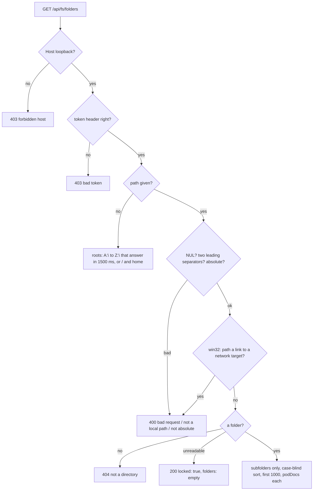

# Server

## What it is

The API server (`packages/server`) finds the repos to show, reads their pod docs, agent transcripts and port claims, asks `gh` about live PRs, builds one `Board`, keeps it current as files change, and serves it to the web app. It also lists folders for the folder picker. It writes only its own config folder (config, session token, action log, toggles, resume logs) and one line of a repo's `pod-docs/handoff-queue.md`. Covers the features.md rows API health, Board JSON, Folder listing, Live updates, Add repo, Request guard, Action token, and Error banners (server side). The actions are in [actions.md](actions.md) and [resume.md](resume.md).

## How it works

- **Repos:** paths in the config file plus every repo a claim file names, merged by normalized path (case-blind where the file system is). `source` is `registered`, `claim`, or `both`.
- **Each repo:** pod docs → the model (a doc whose real path leaves the repo's real path is skipped); recent pod-agent transcripts → parsed runs through a cache keyed by size and mtime, never text; PRs from a `gh` cache refreshed every 30 s. One bad repo sets its `error`; the others still build.
- **`gh`:** run by the absolute path of the first `gh.exe` / `gh.com` (`gh` on POSIX) in an absolute `PATH` entry; asked only about live PRs (current-sprint PRs, hand-back PRs, a fix claim's or a plan's PR by head branch).
- **Watching:** one watcher per folder; a rebuild after 300 ms of quiet, never later than 1.5 s after a burst starts. Clients get a Board over SSE only when its JSON changed.
- **Guards,** in order, the first failure answers:
  - every route: a loopback `Host` on the API or web port (`403 forbidden host`), and an exact `Origin` on writes. No CORS headers; both ports bind `127.0.0.1`.
  - `/api/actions/*` and `POST /api/repos` (`actionGuard`): Origin, a body over 64 KB (`413`), POST, `application/json`, the token, a JSON object.
  - `/api/fs/*` (`readGuard`): the token only, no `Origin`.
  - The token is a fresh random value per API start in `<config dir>/session-token`; Vite puts it in the page's `<meta name="pod-board-token">`, and the page sends it as `X-Pod-Board-Token`. Compared in constant time. Never in the Board, a URL, a cookie, or `pnpm build` output.
- **Add repo:** a local absolute path only; a Windows path starting with two separators → `400 not a local path` before any file system call.
- **Folder listing** (`GET /api/fs/folders[?path=]`, `folder-list.ts`, `guard.ts`, `app.ts`):

  Example: `?path=E:/Projects` → `{ path: "E:\\Projects", parent: "E:\\", locked: false, truncated: false, folders: [{ name: "pod-board", path: "E:\\Projects\\pod-board", podDocs: true }, …] }`. With no token → `403 {"error":"bad token"}`; `?path=%5C%5Chost%5Cshare` → `400 {"error":"not a local path"}`.
  - A link counts as a folder only when it ends at a local folder. On Windows each target is read with `readlink` and a network or device target is dropped before anything follows it; a linked `pod-docs` reads `false`. Files and broken links are left out. It reads names, types and link targets, never a file, and stores nothing.

## Why it's this way

- **Loopback, a Host check, and an `Origin` check for writes:** DNS rebinding is the risk even for a read-only server, and a 2026 advisory showed Host alone isn't enough for a server with write tools ([research](../research/board-actions.md)).
- **The folder listing needs the token but not an `Origin`:** it shows the whole disk's folder names, so a page on another site must not read it. Browsers leave `Origin` off same-origin GETs, so `actionGuard` (which needs one) couldn't guard it; a new `readGuard` does ([plan](../plans/calm-dashboard.md#key-decisions)).
- **Folders only, with a `pod-docs` mark, refusing UNC and device paths:** the pattern Syncthing, Jellyfin and Radarr use behind a key ([research](../research/folder-picker.md)). Opening a share on Windows can send your login to another machine, so link targets are checked before any `stat`.
- **Windows drives by trying `A:` to `Z:`:** Node has no API to list drives; a drive that doesn't answer in 1500 ms is left out (sprint contract), so one slow drive doesn't hold up the roots.
- **Add repo needs the token:** a registered repo is a folder the board reads and runs `gh` in.
- **`gh` by absolute path from absolute `PATH` entries:** a `gh.exe` planted in a cloned repo could otherwise run on the 30 s refresh.
- **A new token per launch** keeps `dist` free of it. Trade-off: a page from before a restart must reload.
- **Quiet spell plus a cap** ([decision](../decisions.md#2026-10-19--fix-live-update-starvation-before-the-final-review)); **parsed runs, not text, in the cache** (the text cache held about 1 GB); **no transcript size cap** ([decision](../decisions.md#2026-10-23--no-size-cap-on-transcripts)).

## Watch out

- The listing checks only the last part of a typed path for a link to a share: a link in the middle (`C:\x\link\sub`) is followed (queue, someday). Making one needs admin rights and the token.
- An empty `?path=` is `400 not absolute`; leave `path` out for the roots.
- More than 1000 subfolders: `truncated: true`, and the picker can't prefix-filter past the cut (queue, someday).
- Compare real paths with `path.relative`, never a string prefix: `C:\x-other` starts with `C:\x`.
- Never spawn a child by a bare name with a repo as its working folder: use `resolveBin` and `safeChildEnv` (`bin-path.ts`).
- Keep Vite's dev `cors: false`. Through the proxy, a stopped API answers `502` with an empty body.
- Point `POD_BOARD_CONFIG_DIR` and `POD_BOARD_PORTS_DIR` at temp folders in tests and smoke runs. From Git Bash, send a UNC test path URL-encoded.
- The rebuild chain must never stay rejected; keep the cap timer apart from the quiet timer.
- Ctrl+C waits up to 70 s for running actions; don't wait for `server.close()` (open SSE streams keep it from finishing).

## History

- 2026-10-18 · server-runs A1: board service, watcher, SSE, and repo routes.
- 2026-10-19 · board-engineer T1: agent timeline route.
- 2026-10-19 · board-engineer X1: `configError` on the Board; `livePrNumbers` uses the model's `handBackPr`; the server imports the model's contract types.
- 2026-10-19 · board-engineer wave 2 fix: config edits reach the board through the watcher; poll mode waits one poll interval longer before a rebuild; a new `ghCheckedAt` counts as a change while `gh` isn't `ok`.
- 2026-10-19 · board-engineer wave 2 fix 2: a rebuild waits at most 1.5 s after a burst's first event, so steady edits still reach clients.
- 2026-10-19 · board-read · plan complete; final PR held at gate 2 for a dispatch bug outside the server · [report](../reports/board-read.html)
- 2026-10-19 · board-read fix 2: `/api/board` no longer serves agent descriptions.
- 2026-10-19 · board-read fix 5: the board count for a quick burst is tested with a fake watch over real files; the real-file test checks only the 5 s bound and the last board.
- 2026-10-20 · board-read · final review passed at round 5; every server row driven live · [report](../reports/board-read.html)
- 2026-10-20 · fix-closeout-idle: `livePrNumbers` also asks about a claimed archived plan's hand-back PR, so its Ship step can read merged.
- 2026-10-20 · fix-show-fix-runs: `gh` also finds a fix claim's PR by its head branch (`getBranch`), so a fix run's Ship step reads `you merge` or `merged`.
- 2026-10-21 · fix-final-pr-early: `gh` also finds a plan's final PR by head branch `<plan-slug>` while the plan is in its final review or close-out with no hand-back, so Ship shows it before the hand-back exists.
- 2026-10-21 · fix-cache-transcripts: the board keeps each transcript's parsed run, not its text, and parses only files whose size or mtime changed. On a real `~/.claude`: heap after the first board 986 MB → 13 MB, a rebuild with nothing changed 5 s → 69 ms. The timeline route reads its file fresh.
- 2026-10-21 · merge-actions S1: per-launch session token, the action guard on `/api/actions/`, the page's token meta, and the action client. Vite's dev CORS turned off.
- 2026-10-21 · merge-actions M1: merge-preview and merge routes; `ExecResult.stderr`, a per-call exec timeout, and `GhCache.forget`; `Board.actions` from the action log.
- 2026-10-21 · queue-and-replies A1: `POST /api/actions/answer`, the server's one write into a repo's queue.
- 2026-10-22 · board-actions · plan complete: action token, `Origin` check, and the action guard on every action route; final PR #33 passed review at round 2 after fix PR #34 · [report](../reports/board-actions.html)
- 2026-10-22 · fix-security-hardening: `gh` runs by an absolute path from absolute `PATH` entries only (a `gh.exe` in a repo could run); `POST /api/repos` needs the session token and refuses UNC and device paths unread.
- 2026-10-23 · fix-hardening-2: pod docs whose real path leaves the repo are skipped; `/api/actions/*` and `POST /api/repos` bodies over 64 KB get `413`.
- 2026-10-25 · fix-background-loops: a watch that fails to open or close is logged, and later rebuilds still run.
- 2026-10-25 · test-main-boot: `main.test.ts` starts the real API from `main.ts` on temp folders and checks health, the Board, the token file, and the action guard; on macOS and Linux also a clean exit on SIGTERM.
- 2026-10-25 · fix-shutdown-drain: Ctrl+C waits for running merges, answers, resumes, and auto-continue sends before exiting, so their action-log lines aren't lost; a second Ctrl+C quits now.
- 2026-10-28 · calm-screen F1: `GET /api/fs/folders` (the folder listing for the picker) behind a new read guard on `/api/fs/*`; the token compare is shared with the action guard.
- 2026-10-28 · calm-dashboard · plan complete: the folder listing and its read guard ship with the folder picker; final PR #54 passed review at round 1 · [report](../reports/calm-dashboard.html)
- 2026-10-30 · fix-run-flow · the repo read adds `pod-docs/decisions.md` and the `.md` reports directly in `pod-docs/research` (same real-path and size rules); gh reads each PR's `baseRefName`, and `refresh` takes staging heads (`stagingBranches`) that are asked about every 30 s even after a merge, since every plan reuses the staging branch.
- 2026-10-30 · fix-run-flow review round 1 · gh also reads each PR's `mergedAt` (read-only `--json`), so a staging PR can be told apart from the last plan's by merge time.
