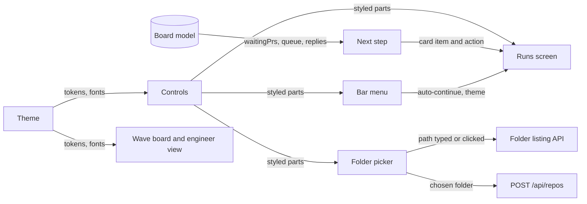
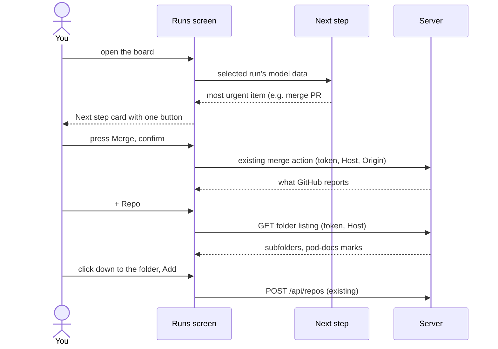

# Plan: Calm dashboard

_Generated: 2026-10-27 · Status: active · Grilled-with: pod_

Port base: 3000

<!-- autopilot-run: started=2026-10-28T08:11:52Z sprints=0 waves=0 -->

## Goal
Make screen 1 (Runs) calm. When you open it, you see in a couple of seconds what pod needs from you, if anything, and how to do it, and everything else is one click away. At the same time, the whole board moves to a dark-first, black-and-white look in the style of Vercel, and "+ Repo" picks a folder from a folder browser instead of a typed path.

## Why
After the first pod-trial run, the human found the dashboard too busy: the Reply panel, the Merge button on a pipeline step, the Waiting on you list, the session commands, the Action log, the Add a repo form and the theme control all show at once, with large gaps at 375 px.

**Success criteria:**
- At 375 px, the one thing to do next and its button show without scrolling.
- With nothing to do, the screen clearly reads "nothing to do".
- No action, queue entry or command is lost: each is at most one click away.
- A repo can be added by clicking down to its folder, without typing a path.

**Constraints:**
- Every action keeps working as today: Merge with its confirm step, Answer, Continue, Go, the auto-continue switch, and Copy. The board still does exactly what the human would do by hand.
- The security rules stay: the per-launch token, the `Host` and `Origin` checks, the 127.0.0.1 binding, and no UNC or device paths.
- Fonts are self-hosted, and nothing loads from another host.
- Works on Windows first, then macOS and Linux.

## Scope
**In scope:**
- **New look for the whole board** (see Look): tokens, fonts, controls, and status shown as a dot plus a word. The wave board and the engineer view take the new tokens and fonts, but their layout doesn't change.
- **Screen 1 restructure** (plan runs and fix runs):
  - **Next step card:** for the selected run, it shows the most urgent thing with its one button, in this order: a `BLOCKED` entry, a PR waiting for you to merge, a reply to send (`continue`, `go` or `try`), then other `PENDING` entries. With nothing waiting, it shows a quiet "Nothing to do" card. The card never folds. Merge's confirm step and the Answer form open in place under the card.
  - **Tabs under the card:** Waiting (with a count), Plan, Log. All start closed, so the page ends under the card. The board remembers the open tab per browser.
    - **Waiting:** every entry that waits on you, 2 lines each, expanding on click, with Answer.
    - **Plan:** one plain line per pipeline step, with a detail line only on the current step, and a link to the wave board.
    - **Log:** the slice log, other agents running, and the Action log.
  - **Header:** the plan's name, a progress strip (one segment per step), and "Wave N of M".
  - **⋯ menu in the bar:** the auto-continue switch for the selected run, the theme (System, Dark, Light), and the ports note.
  - **Removed, because something else already says it:**
    - the `live` chip, which shows only when the connection is lost;
    - the run subtitles in the runs list;
    - the card's "and N more" line;
    - the long explanations, cut to one short line.
  - **Moved behind "Run it yourself" on the reply card:** the session commands (`cd`, `claude --resume`, Copy continue).
  - **Big gaps at 375 px** are fixed.
- **Folder picker for "+ Repo":**
  - A panel opens in place under the bar, starting in the folder that holds the existing repos.
  - You click down through drives and folders, or type a path that fills in as you type.
  - Folders that contain `pod-docs` are marked.
  - Adding still goes through today's `POST /api/repos`.
- **Folder listing API** on the server: folders only, any drive, behind the session token and the `Host` check, refusing UNC and device paths.

**Out of scope:**
- Layout changes to the wave board and the engineer view.
- A native OS folder dialog ("Browse…"), and scanning a folder to add every pod repo in it.
- A Next step card across all runs. The runs list's status already marks other runs that need you.
- New actions. Every button on the new screen exists today.

## How it fits together
The server gains one read route, and the web app gains a pure Next step module, a new screen 1 layout, a bar menu and a folder picker. The model package doesn't change: the Next step module picks from what the model already gives (`waitingPrs`, the queue entries, the reply view).

**Parts:**

| Part | New or changed | Where (existing folder or module) | Does |
|------|----------------|-----------------------------------|------|
| Theme | changed | `packages/web/src/theme/` | Geist tokens and fonts, dark by default, light and System kept |
| Controls | changed | `packages/web/src/theme/` (shared control styles) | Buttons, inputs, switch, tabs, menu and status dot in the new look |
| Next step | new | `packages/web/src/screens/runs/` (pure view module) | Picks the selected run's most urgent item and its action from model data |
| Runs screen | changed | `packages/web/src/screens/runs/` | Card, tabs, header with progress strip, folded sections, remembered tab |
| Bar menu | new | `packages/web/src/screens/runs/` | Auto-continue, theme and ports in one menu |
| Folder picker | new | `packages/web/src/screens/runs/` (replaces the Add a repo form) | Folder browser with typing and `pod-docs` marks; adds through `POST /api/repos` |
| Folder listing | new | `packages/server/src/` (route plus a listing module) | `GET` lists subfolders of a path, or the drives and roots, with a `pod-docs` flag |
| Wave board, engineer view | changed (look only) | `packages/web/src/screens/board/`, engineer screen | Take the new tokens and fonts |

**How they connect:**

**Main flow:** you open the board, see the Next step card, and act on it. Adding a repo goes through the folder picker.

**Data:**
- `config.json` in the board's config folder: unchanged.
- Browser `localStorage`: `pod-board-theme` (existing; nothing stored now means Dark), plus a new key for the open tab on screen 1.
- The folder listing reads directory names only. It stores nothing and never reads file contents.

## Sprint sequence

| Sprint | Goal | Status | Depends on |
|--------|------|--------|------------|
| calm-screen | New look, the calm screen 1 and the folder picker | active | — |

Status: `planned` / `active` / `done`. `Depends on` is the only dependency between sprints.

## Look
The human picked direction C, simplified, then redrawn "like Vercel": dark first, mainly black and white, more space, and no colored card edge. This replaces the board-read look (slate and cobalt, Bricolage Grotesque, Instrument Sans, JetBrains Mono, chips and card edges).
- **Thesis:** a quiet black-and-white page where only the next step stands out, in the style of Vercel's dashboard.
- **Palette (dark / light):**
  - bg `#000000` / `#ffffff`, surface `#0a0a0a` / `#fafafa`, hover `#1a1a1a` / `#f2f2f2`
  - border `#262626` / `#eaeaea`, border-strong `#3a3a3a` / `#d4d4d4`
  - fg `#ededed` / `#171717`, muted `#a1a1a1` / `#666666`, faint `#6e6e6e` / `#8f8f8f`
  - primary button: bg `#ededed` text `#0a0a0a` / bg `#171717` text `#ffffff`
  - status dots, plus the ready green on the ✓ of finished steps in the Plan tab: blocked `#ff5f5f` / `#d0262f`, needs you `#f5a623` / `#b25d00`, running `#52a8ff` / `#0068d6`, ready `#3ecf72` / `#1a8a45`, idle `#8f8f8f` / `#7d7d7d`
  - focus ring and link hover: `#52a8ff` / `#0068d6`
- **Type:** Geist (UI and headings) and Geist Mono (paths, commands, numbers, labels), self-hosted, both OFL. Body text 16 px; secondary text 14 px; mono 13 px; small labels 12 px at the least. Headings weight 600 with slight negative tracking.
- **Layout:**
  - Screen 1 on desktop: the runs list on the left, and a narrow main column (about 720 px) with the header, the Next step card and the tabs.
  - At 375 px, the runs list stacks above the main column, and the page ends under the card until a tab is opened.
  - Spacing: 24 px inside cards, about 40 px between sections, buttons 40 px tall with 20 px side padding (32 px small with 12 px), labels 14 px / 500 at both sizes. Icons are 16 px SVGs (1.5 px stroke), never text glyphs such as `+` or `⋯`; the icon side gets less padding (16 px, or 10 px small) so the label looks centered. Icon-only buttons are square.
- **Signature detail:** the progress strip beside the plan's name. Done steps are white segments, the current one is dimmed, and the rest are grey.
- **Rules out:**
  - colored card edges and color fills on cards;
  - state shown by color alone (every status is a dot plus a word);
  - blue primary buttons;
  - gradients, and shadows on cards (only the menu has one);
  - default browser controls;
  - a single theme.
- **Draft:** [`pod-docs/design-drafts/calm-dashboard-look-3.html`](../design-drafts/calm-dashboard-look-3.html) (Vercel style, picked). Earlier steps: [`calm-dashboard-look.html`](../design-drafts/calm-dashboard-look.html) (A, B, C; C picked) and [`calm-dashboard-look-2.html`](../design-drafts/calm-dashboard-look-2.html) (simpler C).

## Key decisions
- **Research on the web skipped for the dashboard;** the problems were known from the pod-trial run.
- **One Next step card for the selected run only.** Its order: `BLOCKED`, a PR to merge, a reply to send, then other `PENDING` entries. It reuses the model's rules (`waitingPrs`, the replies, the queue entries that ask you) rather than adding new ones.
- **A new look for the whole board, replacing the board-read Look.** The human asked for a Vercel-style, black-and-white, dark-first look. This also makes the 2026-10-19 decision "light chip text: darker ink tokens" obsolete, since chips give way to status dots; record that in [decisions.md](../decisions.md) when the sprint lands. Contrast still has to pass 4.5:1 for text.
- **Dark by default.** With nothing stored, the theme is Dark, not System as today ([app-shell](../feature-details/app-shell.md)). System and Light stay in the ⋯ menu.
- **Tabs start closed, and the open tab is remembered per browser.** The Next step card never folds.
- **The Pipeline / Wave board tabs at the top go away.** The wave board opens from a link in the Plan tab, and its URL stays the same.
- **The folder picker is a folder browser in the page, not the OS dialog** ([research](../research/folder-picker.md)). No browser picker returns a full path. Syncthing, Jellyfin, Emby and Radarr list folders from the server, behind a key. A native dialog can open behind the browser, and the research found no real project that opens one from a local server.
- **The listing covers every drive, folders only, with a `pod-docs` flag.** It starts in the parent folder of the existing repos. It's behind the session token and the `Host` check, and it refuses UNC and device paths, like adding a repo does ([decision](../decisions.md)).

## Known risks
- **Restyling every screen can break layouts the wave board and engineer view rely on,** such as the dependency lines and the sideways scroller. Mitigation: check every `pod-docs/features.md` browser row at desktop width and 375 px.
- **The Next step order could disagree with what the old panels showed.** Mitigation: build it as a pure function over the same model data the old panels used, and test it against the fixtures that already cover `waitingPrs`, the replies and the queue.
- **Folder listing exposes folder names to anything holding the token.** Mitigation: the same guard as the actions, folders only, no file contents, and refusing UNC and device paths. A folder the board can't read shows as locked instead of failing.
- **Windows has no Node API to list drives.** Mitigation: check `A:` to `Z:` for a root that exists; on macOS and Linux, start at `/` and the home folder.
- **Dark-first colors may fail contrast for muted text and status words.** Mitigation: check 4.5:1 for text in both themes, as the 2026-10-19 decision did.

## Open questions
- none

## Verification
- At 375 px, on a run with a PR waiting, the Next step card and its Merge button show without scrolling, and the page has no sideways scroll.
- On a run with nothing waiting, the card reads "Nothing to do" and has no button.
- With a `BLOCKED` entry and a PR waiting at once, the card shows the `BLOCKED` entry, and the Waiting tab's count includes the rest.
- Every action that worked before still works from the new screen: Merge with its confirm step, Answer, Continue, Go, the auto-continue switch, Copy continue, and the `cd` and `claude --resume` commands.
- A repo is added by clicking down to its folder in the picker, with no typing. A folder with `pod-docs` shows its mark.
- The folder listing refuses a request with no token or a wrong `Host`, refuses UNC and device paths, and never returns files.
- With nothing stored, the board opens in Dark. Theme, ports and auto-continue work from the ⋯ menu.
- No state anywhere on the board is shown by color alone, and text passes 4.5:1 contrast in both themes.
- Fonts load from the board itself, and no request goes to another host.
- Every browser row in `pod-docs/features.md` passes, including the wave board and the engineer view.
